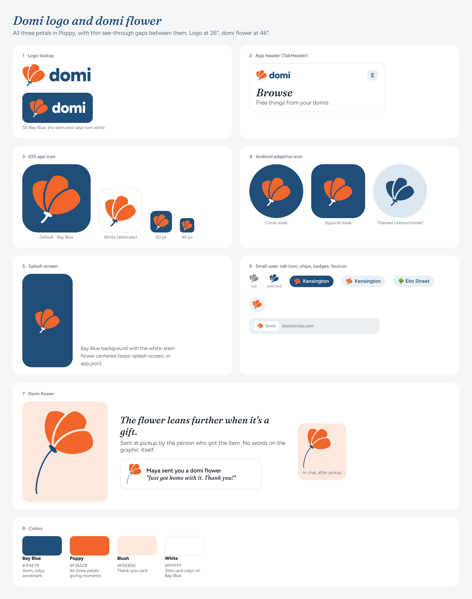

# Domi — Brand Strategy

Updated Nov 6, 2026 · Ellen O'Connor. Replaces the "Domi Circles — Brand Strategy (Draft)" Google Doc of Oct 16, 2026. Changes since then: "domi" replaces "circle" as the word for a community, the logo is now a leaning poppy instead of the ring, the thank-you poppy has been added, and the product facts now match the MVP in `docs/spec.md`.

## Summary

**Domi is the good neighbor, organized.** It should feel as warm as a Buy Nothing group and as dependable as eBay, with none of Facebook's noise.

The visual direction is **Neighborhood Modern on clean white, in Fog & Poppy**: Bay Blue, one California-poppy accent, and **a simple poppy as the logo**. It should feel like a quirky but organized and beautiful museum, never a hospital room. Sustainability is the result we talk about, not the costume we wear.

The name does real work here. *Domi* is Latin for "at home," and a **domi** is what we call the group of people near you who share what they have. Every brand choice should feel like something good happening close to home.

## What Domi is, and what that means for the brand

Domi is an app for giving things away for free, within a neighborhood or a group of people you already know. It keeps what's good about Buy Nothing's gifting and automates the painful parts.

Five product facts shape the brand most:

- **Neighborhoods and domis are the core units.** Everyone is in their neighborhood (by zip code). Anyone can start a domi, an invite-only group, and share its link. The poppy, the group around a center, is the visual motif.
- **No comment threads.** Neighbors request with one tap and an optional note; the giver picks someone; a private chat opens for pickup. The brand should feel calm and orderly.
- **Wishes run the other way.** Post what you need; neighbors offer; you pick the one that works. Giving can be an answer, not just a broadcast.
- **Reliability without a score.** There is no karma. Missed pickups are tracked privately and only pause repeat no-shows. The brand makes showing up feel like pride, never policing.
- **Thanks closes the loop.** At pickup, the person who got the item can send the giver a domi flower, a thank-you poppy (see "The domi flower").

Later, not now: selling, price drops, bidding and escrow from the original white paper. They are out of scope for the MVP and the brand shouldn't promise them.

The launch goal is one thriving, invite-driven domi in the East Bay (Berkeley, El Cerrito, Kensington), which gives the brand a real place to be from.

## Target audience

Design for the **eco-minded East Bay parent first**: the overlap of the white paper's eco-conscious and busy-parent segments. They give the most, they already use Buy Nothing, and they recruit other parents. Treasure hunters follow the supply. Friendly neighbors become the ambassadors and start domis.

| Segment | Wants | Friction today | Brand must signal | Proof in product |
| --- | --- | --- | --- | --- |
| Eco-conscious (25–45) | Give without effort; feel good about impact | Tedious threads on Buy Nothing, Freecycle, Marketplace | Values match, no greenwashing | Free only; one-tap requests; items reach a new home fast |
| Busy parent (30–50) | Declutter kids' gear fast; help other families | No time for back-and-forth | Time respected, family-safe | Private requests; giver picks; one pickup chat |
| Treasure hunter (18–35) | Free essentials and good finds | Sketchy strangers, first-come races | Fair and safe | Wishes; giver chooses, not fastest finger |
| Friendly neighbor (35–65) | Connection and helping out | Groups run by hand by volunteer admins | Belonging and local pride | Start a domi; invite links; poppies |

### Six insights that drive the brand

1. **They are leaving Facebook over values, not features.** Domi must look and act like the opposite: no ad clutter, no engagement bait, no outrage.
2. **The pain is people, not stuff.** Flaking and public comment threads waste time. The promise is reliability, so the look should feel calm and ordered.
3. **Giving is emotional; pickup is practical.** Warmth carries the giving; clear structure carries the logistics.
4. **Green is the outcome, not the pitch.** Leaf icons and recycling arrows read as greenwashing to this crowd. Lead with neighborliness and good things. Show impact as quiet proof ("Your domi passed on 42 things this month").
5. **The objects have stories.** Solid furniture, outgrown kids' gear, Bay Bridge lumber. Honor the item and its next home, not inventory.
6. **Local pride is a feature.** Berkeley, El Cerrito and Kensington have strong identities. A sense of place beats generic "community" stock imagery.

## Positioning, promise and personality

**Positioning:** For East Bay neighbors who want good things to find a new home nearby, Domi is the place your domi gives and gets for free, easily and reliably. Unlike Facebook Marketplace or Buy Nothing groups, Domi handles requests, choosing and pickup for you, and makes thanks part of every handoff.

**Brand promise:** Good things find a new home nearby, without the hassle.

Everyone else trades warmth for efficiency or the reverse. Domi's whole brand job is to hold both at once. (The positioning map, feel vs. experience, is in the original Google Doc.)

### Personality

| Domi is | Domi is not |
| --- | --- |
| Warm | Cutesy |
| Dependable | Strict or preachy |
| Quietly witty | Snarky |
| Proudly local | Cliquey |
| Generous | Pushy about sustainability |

### Voice in practice

| Moment | Say this | Not this |
| --- | --- | --- |
| Item posted | "Your stroller is out in Kensington. Your domi can see it now." | "Listing successfully published." |
| Picked | "The crib is yours! Reply to plan pickup." | "Ellen chose you." |
| Might flake | "Can't make it? Tell Jordan now so they can offer it to someone else." | "Failure to appear will be recorded." |
| Handoff done | "Passed on. Send Maya a poppy?" | "Order complete." |
| Invite | "Sam invited you to the Elm Street domi." | "You have a new group invitation." |

## Visual aesthetic direction

**Decided: Neighborhood Modern on clean white, in Fog & Poppy, with a poppy as the logo.** The feel is a tiny museum of your neighborhood: white walls, a strict grid, and every object given room and a story. Simple must never read as clinical. Earlier mockups live on the [design canvas](https://claude.ai/artifact/Dsi6sXpudjRLXywcLcyCoc); they still show the old ring logo.

### The museum idea in practice

- **Organized:** white background, generous margins, one grid, one label per object. No cream, no paper textures.
- **Quirky:** Fraunces Italic, soft and slightly wonky, for curator moments: headings, item captions, empty states. A dry, kind curator's voice ("Outgrown, not outrun.").
- **Beautiful:** real objects in good light, large photos, nothing competing with them.
- **Warm, not clinical:** warmth comes from the poppy, the writing, real photos and the Blush tint, never from a cream background.

### Logo: the leaning poppy

**Approved Nov 6, 2026.** A simplified California poppy seen from the side: three broad, round-tipped petals rising from a small cupped base (the calyx) on a short stem, leaning 26° to the right, because real poppies nod.

- **Simple, not literal.** Three flat petals, all Poppy, with thin see-through gaps between them (style A, Nov 7). No outlines, no stamens, no leaves.
- **One color, never blended tones.** An earlier version used three Poppy tones that blended where the petals overlapped, which read too close to Mastercard's overlapping circles. The gaps keep the petals distinct; they are real gaps (an SVG mask), so they show whatever is behind the mark.
- **Round tips, never pointed.** Pointed petals turn it into a lotus (spa and yoga territory).
- **The calyx and stem keep it a flower.** Without them, three petals fanning from one point read as a butterfly. Don't replace them with a dot.
- **The lean is the personality.** 26° for the logo and icon. Don't straighten it, and don't lean it further: past about 30° the icon looks like it's falling over.
- **Stem and calyx are Bay Blue on light backgrounds, white on Bay Blue.** The petals never change color.
- **The mark stands beside the wordmark; it doesn't replace a letter.** The wordmark is "domi" in Figtree ExtraBold, Bay Blue (white on Bay Blue). The mark can always appear alone.
- **App icon:** the white-stem poppy on Bay Blue. A white icon with the Bay Blue stem is the alternate. Android's themed icon and the Domis tab icon use the same shape in one color.
- **Avoid:** blended or overlapping warm tones (Mastercard), pointed petals (lotus), a dot instead of the calyx (butterfly), a tall narrow cup on a long stem (torch or tulip), green stems or leaves (eco cliché), red with a black center (the remembrance poppy), overlapping filled circles (Mastercard), and house or door shapes (Nextdoor).
- **How we got here:** a four-petal top-down poppy read as a toy or a button; tall side views as a tulip or torch; a detailed traced poppy was lovely but fussy at small sizes; abstract shapes (sunrise, cupped hands, a single petal) drifted into clichés. The simplified leaning poppy kept the warmth and survives at 16 px.
- **Files** in `docs/brand/`: `domi-mark.svg` (light backgrounds), `domi-mark-on-blue.svg` (white stem), `domi-app-icon.svg` (1024 px, Bay Blue), `domi-app-icon-white.svg` (alternate), `domi-thanks.svg`. In the app the mark is drawn by `PoppyMark` in `src/ui/Logo.tsx`.

### The domi flower (thank-you poppy)

- Called a **domi flower** in the app. From pickup time on, the person who got the item can send the giver one, with an optional short note. One per handoff, always optional, never the first thing asked for.
- It's the same poppy leaning further, 46°, on a thin Bay Blue stem that follows the lean and then curves down, like a picked flower being handed over (`domi-thanks.svg`). Shown on a Blush card ("Maya sent you a domi flower"). No words on the graphic itself.
- **Poppies count for the domi, not the person.** No totals on profiles, no leaderboards. A domi can show its collective bloom ("Elm Street domi: 48 poppies this fall"). Pride in the group, never a score.
- Motion: one gentle bloom when it arrives. No confetti.
- Not yet in `docs/spec.md`; it needs a spec entry and a place in the build plan before it's built.

### Color

| Role | Name | Hex | Use |
| --- | --- | --- | --- |
| Background | White | #FFFFFF | Every screen |
| Primary | Bay Blue | #1F4E79 | Wordmark, logo stem and calyx, app icon, buttons, navigation, selected states |
| Accent | Poppy | #F2652B | Giving moments only: free items, domi flowers, the logo's petals |
| Warm tint | Blush | #FDE8DE | Highlight surfaces, thank-yous, celebrations, empty states |
| Cool tint | Fog | #EAF0F4 | Photo backgrounds, chips, search |
| Text | Ink | #18222E | Body text and icons |

- **Poppy means generosity.** Never use it for warnings, errors or missed pickups.
- **Text on Poppy is always Ink** (5.1:1 contrast). White on Poppy fails at 3.1:1. White on Bay Blue passes at 8.7:1.
- **Keep the blue deep and muted.** No bright blue anywhere; that is Facebook's color.
- **Still needed:** a small functional set for success, errors and item states that does not compete with Poppy.

### Typography

- **Fraunces Italic** for headlines, captions and the curator voice.
- **Figtree** for the wordmark, interface, times and buttons.

### Shape language

- **Round means people and domis:** the poppy, avatars, and the poppy dot on free items (like a gallery's sold sticker).
- **Rounded rectangles mean things:** photo tiles and cards.

### Imagery and motion

- Real items in real homes, natural light, generous crops. Give listers a simple framing guide.
- Motion is small and calm: a soft ripple when you post, a short warm bloom on a completed handoff. No confetti, no slot-machine effects.

### What Domi should never look like

- Facebook blue, ad slots between listings, or red badges everywhere
- Leaf-and-recycling eco clichés, green stems and leaves included
- Cream paper, thrift-store kitsch or mid-century palettes
- Busy, crowded feeds, scores or gamer-style XP bars

## Naming: Domi, and a domi

**Decided (Nov 6): Domi is the brand, and "domi" is also the word for a community in the app. "Circles" is retired from all user-facing copy.**

- **Definition:** **domi** (n.), *pl.* **domis**: the people near you who share what they have. Use the same line on the website, the App Store page, the intro cards and every invite page.
- **Two kinds, two words:** your **neighborhood** (by zip; just "your neighborhood", never "neighborhood domi") and **domis**, the invite-only groups people start and name ("Elm Street," "Sam's baby shower").
- **Copy rules:**
  - Inside the app, don't refer to the app by name; there, "domi" always means a community. "Domi" as the product name lives outside: the store, the website, push sender names.
  - Never use "domi" alone in copy. Attach an article, a name or an owner: "Start a domi," "Leave this domi," "Sam's domi."
  - Keep "domis" rare. Where a line means the people who'll see something, name the people: "Your friends are looking for," "your neighbors and friends will see it," "Only the people you share with see what you post." Use "domis" only for a count or a list of groups ("in 3 domis," "Your domis").
  - The app's tabs show icons only; the Domis tab is the poppy.
  - Coin one word only. No "domi-mates," no "to domi."
- **Pronunciation:** to decide (DOH-mee?) and state once in the intro and on the site.
- **Code:** the database keeps `communities`. Only the copy changes.
- **Domains and handles:** domicircles.com and @domicircles are in use today. Whether to move to a name without "circles" is an open question (below).
- **Retire "Corcles"** everywhere, including the product doc and white paper.

### Lines to use

- "Domi is where the heart is."
- "It takes a village. It takes a domi."
- "Find your domi." / "Start a domi."
- "Every block deserves a domi."
- "What's your domi?"
- "There's no word for the people on your street you'd lend a ladder to. So we made one."

## Open questions for your review

- ☒ Visual direction: Neighborhood Modern on white, Fog & Poppy
- ☒ Name: Domi; "your neighborhood" for the zip group, "domi" for invite-only groups (copy changed Nov 6)
- ☒ Logo: the leaning poppy, beside the wordmark (approved Nov 6)
- ☐ Pronunciation of "domi"
- ☐ Domain and handles: keep domicircles.com / @domicircles, or find one without "circles"?
- ☐ Is the eco-minded East Bay parent the right primary audience for launch, or students (move-out swaps)?
- ☒ Domi flower: sent by the person who got the item, from pickup time on, note optional (built Nov 6; spec in `docs/spec.md`)
- ☐ Functional colors for item states, success and errors
- ☐ Trademark search on "Domi"

Next steps: a pronunciation for "domi", and later a collective "bloom" per domi.
